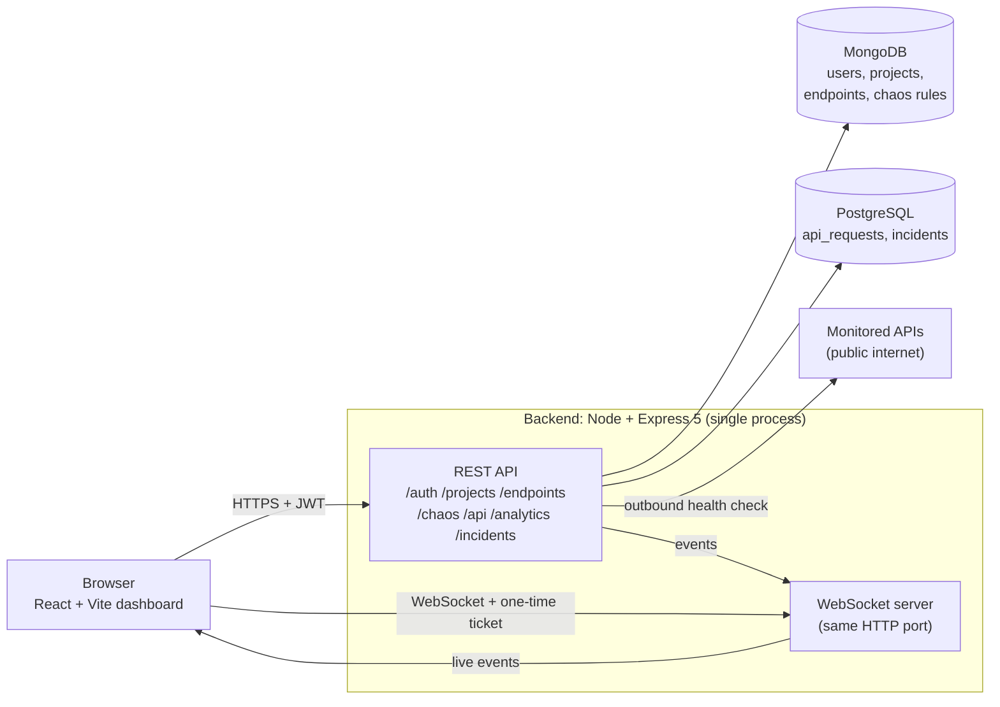
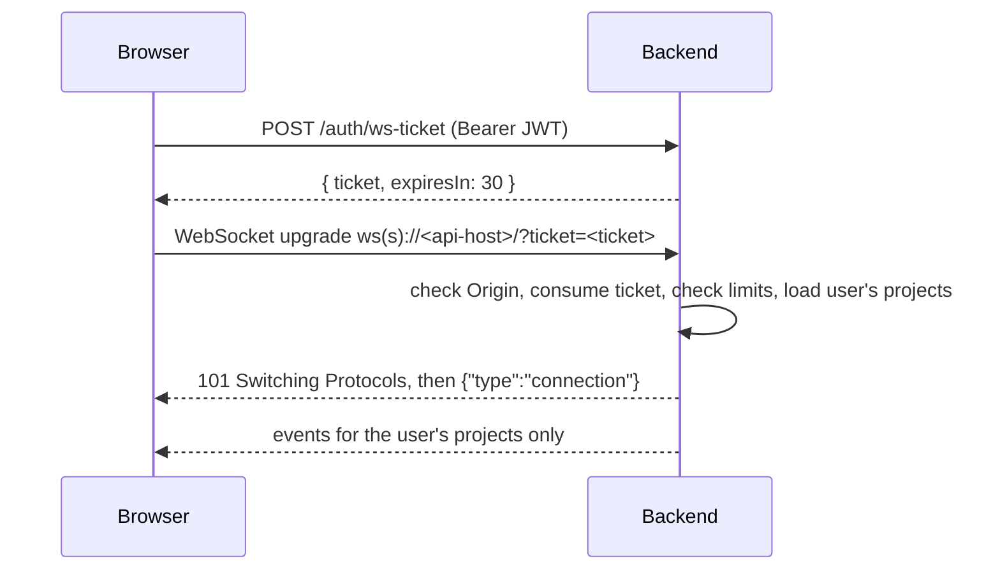

# PulseForge

PulseForge is a real-time API chaos and observability platform. You register
HTTP endpoints you want to watch, run health checks against them, inject
faults (added delay and simulated error responses), and watch latency, error
rates and incidents update live in the dashboard over a WebSocket.

It is built for experimenting with how an API behaves and recovers under
failure, not as an always-on uptime monitor: checks run when you trigger them
from the dashboard, and there is no background scheduler.

## Contents

- [Architecture](#architecture)
- [Features and workflows](#features-and-workflows)
- [Prerequisites](#prerequisites)
- [Local databases with Docker](#local-databases-with-docker)
- [Environment variables](#environment-variables)
- [Running locally](#running-locally)
- [Tests, lint and builds](#tests-lint-and-builds)
- [REST API](#rest-api)
- [WebSocket](#websocket)
- [Security protections](#security-protections)
- [Latency and incident semantics](#latency-and-incident-semantics)
- [Operations](#operations)
- [Deployment](#deployment)
- [Known limitations](#known-limitations)

## Architecture



**What happens on a health check** (`GET /api/:id/check`):

1. The backend loads the endpoint and its project from MongoDB and checks that
   the project belongs to the signed-in user.
2. If the endpoint has an enabled chaos rule, the configured delay is applied,
   and with the configured probability a simulated error is returned instead
   of calling the real API.
3. Otherwise the backend calls the monitored URL through a hardened outbound
   client (see [Security protections](#security-protections)).
4. The result (status code, latency, success or failure) is written to the
   PostgreSQL `api_requests` table.
5. Incident rules are evaluated for that endpoint, and incidents are opened,
   updated or resolved in the `incidents` table.
6. The request and any incident changes are broadcast over the WebSocket to
   the owner's open dashboards.

**Data split:** MongoDB holds account and configuration data (users, projects,
endpoints, chaos rules). PostgreSQL holds time-series and incident data
(request history, analytics queries, incidents). PostgreSQL tables and indexes
are created or migrated automatically at startup; PostgreSQL 15 or later is
required.

## Features and workflows

1. **Sign up / sign in.** Name, email and password (at least 8 characters and
   at most 72 UTF-8 bytes). The session is a JWT stored by the frontend.
2. **Create a project**, then **add endpoints** to it: a name, a public
   `http`/`https` URL and a method (`GET`, `POST`, `PUT`, `PATCH`, `DELETE`).
3. **Run a check** on an endpoint. The backend calls the URL once and records
   status, latency and success. The request is sent with the endpoint's real
   method, so checking a `POST`/`PUT`/`PATCH`/`DELETE` endpoint performs that
   action against the target API.
4. **Configure chaos** per endpoint: an added delay (0 to 30,000 ms), an error
   rate (0 to 100 %) and the status code returned for injected errors
   (100 to 599). While a rule is enabled, every check waits for the delay and
   then fails with that probability without calling the real API.
5. **Disable chaos and watch recovery.** The dashboard disables the rule and
   runs the consecutive healthy checks needed to resolve a latency incident
   (see [Latency and incident semantics](#latency-and-incident-semantics)).
6. **Watch it live.** Latency chart, per-endpoint analytics with endpoint and
   time-window filters, recent events and the incident panel update over the
   WebSocket as checks run.

## Prerequisites

- Node.js 24 (the backend's `engines` field requires `>=24 <25`) and npm
- Docker, for local PostgreSQL and MongoDB
- Git

## Local databases with Docker

The commands below bind the ports to `127.0.0.1` so the databases are not
reachable from your network. Replace the placeholder with your own value.
Each command is on one line so it works in both bash and PowerShell.

```bash
docker run -d --name pulseforge-postgres -e POSTGRES_PASSWORD=<your-postgres-password> -e POSTGRES_DB=pulseforge -p 127.0.0.1:5432:5432 -v pulseforge-pgdata:/var/lib/postgresql/data postgres:17

docker run -d --name pulseforge-mongodb -p 127.0.0.1:27017:27017 -v pulseforge-mongodata:/data/db mongo:8
```

The local MongoDB container runs without authentication; it is reachable only
from your own machine because of the `127.0.0.1` binding.

PostgreSQL 15 or later is required. The backend creates its tables and
indexes on startup, so no migration step is needed.

Later starts: `docker start pulseforge-postgres pulseforge-mongodb`.

## Environment variables

Copy `backend/.env.example` to `backend/.env` and `frontend/.env.example` to
`frontend/.env`, then fill in the empty values. `.env` files are gitignored;
never commit them.

### Backend (`backend/.env`)

| Variable | Required | Default | Example placeholder | Purpose |
| --- | --- | --- | --- | --- |
| `MONGO_URI` | Yes | – | `mongodb://localhost:27017/pulseforge` | MongoDB connection string |
| `JWT_SECRET` | Yes | – | `<random-string-of-at-least-32-characters>` | Signs session tokens; startup fails if shorter than 32 characters |
| `POSTGRES_PASSWORD` | Yes | – | `<your-postgres-password>` | PostgreSQL password |
| `POSTGRES_HOST` | No | `localhost` | `<your-postgres-host>` | PostgreSQL host |
| `POSTGRES_PORT` | No | `5432` | `5432` | PostgreSQL port |
| `POSTGRES_USER` | No | `postgres` | `<your-postgres-user>` | PostgreSQL user |
| `POSTGRES_DB` | No | `pulseforge` | `pulseforge` | PostgreSQL database name |
| `PGSSLMODE` | No (set it for Neon) | unset | `verify-full` | Read by the `pg` driver; `verify-full` enables TLS with certificate verification |
| `PORT` | No | `3000` | `3000` | HTTP and WebSocket port |
| `FRONTEND_URL` | No | `http://localhost:5173` | `https://<your-frontend-domain>` | Allowed CORS and WebSocket origin. Must be a bare `http`/`https` origin: no path, query or credentials |
| `TRUST_PROXY_HOPS` | No | `0` | `0` | Number of reverse proxies to trust for the client IP (0 to 10). See [Deployment](#5-measure-and-set-trust_proxy_hops) |
| `NODE_ENV` | No | unset | `production` | Exactly `production` hides the `/test-success` route |

Connection settings are individual `POSTGRES_*` variables; a single
`DATABASE_URL` is not supported.

One way to generate a `JWT_SECRET`:
`node -e "console.log(require('crypto').randomBytes(48).toString('base64url'))"`

### Frontend (`frontend/.env`)

| Variable | Required | Example placeholder | Purpose |
| --- | --- | --- | --- |
| `VITE_API_URL` | Yes | `http://localhost:3000` | Backend base URL, no trailing slash. The WebSocket URL is derived from it (`http` → `ws`, `https` → `wss`). Read at build time, so rebuild after changing it |

## Running locally

```bash
# 1. Start the databases (see above)
docker start pulseforge-postgres pulseforge-mongodb

# 2. Backend: http://localhost:3000
cd backend
npm ci
npm run dev

# 3. Frontend, in a second terminal: http://localhost:5173
cd frontend
npm ci
npm run dev
```

The backend connects to MongoDB, then PostgreSQL, creates or updates the
PostgreSQL tables, and logs `PulseForge server running on port 3000`.

To run the compiled backend instead: `npm run build`, then `npm start`.

## Tests, lint and builds

```bash
cd backend
npm test          # Vitest
npm run build     # TypeScript compile to dist/
cd ..

npm --prefix frontend test
npm --prefix frontend run build
npm --prefix frontend run lint
```

The backend tests mock MongoDB and PostgreSQL, but they load the real
configuration module, which reads `backend/.env`. The three required
variables (`MONGO_URI`, `JWT_SECRET`, `POSTGRES_PASSWORD`) must be set there
or in the environment, otherwise those tests fail on import.

## REST API

All routes except `/`, `/healthz`, `/test-success`, `/auth/signup` and
`/auth/signin` require `Authorization: Bearer <token>`. Tokens are JWTs that
expire after 7 days. Every resource is scoped to its owner: another user's
project, endpoint or rule returns 404. Request bodies are JSON, limited to
100 kB.

| Method | Path | Purpose |
| --- | --- | --- |
| GET | `/` | API banner |
| GET | `/healthz` | Liveness check: `{"status":"ok"}`. Touches no database |
| GET | `/test-success` | Returns 200, for manual testing only (checks can't target the backend's own `localhost`). Not registered when `NODE_ENV` is exactly `production` |
| POST | `/auth/signup` | Create an account (`name`, `email`, `password`) |
| POST | `/auth/signin` | Sign in, returns a JWT |
| GET | `/auth/me` | Current user |
| POST | `/auth/ws-ticket` | Issue a one-time WebSocket ticket |
| POST | `/projects` | Create a project |
| GET | `/projects` | List your projects |
| DELETE | `/projects/:id` | Delete a project |
| POST | `/endpoints` | Add an endpoint to a project |
| GET | `/endpoints/project/:projectId` | List a project's endpoints |
| DELETE | `/endpoints/:endpointId` | Delete an endpoint and resolve its active incidents |
| POST | `/chaos` | Create a chaos rule for an endpoint |
| GET | `/chaos/endpoint/:endpointId` | List an endpoint's chaos rules |
| PATCH | `/chaos/:ruleId` | Update or enable/disable a rule |
| GET | `/api/:id/check` | Run one health check on endpoint `:id` |
| GET | `/analytics/project/:projectId` | Request counts (total, successful, failed) and average, max and p95 latency |
| GET | `/analytics/project/:projectId/latency` | Latest 100 requests for the latency chart |
| GET | `/analytics/project/:projectId/endpoints` | Per-endpoint analytics |
| GET | `/analytics/project/:projectId/recent-events` | Recent requests |
| GET | `/incidents/project/:id` | `{ active, resolved }` incidents, newest first |

Analytics routes accept optional query filters: `minutes` (time window),
`endpoint` (exact URL), `method`, and `status` (`success` or `failed`).

At most one chaos rule per endpoint is enabled at a time: enabling a rule
disables the others.

### Rate limits

| Route | Limit | Keyed by |
| --- | --- | --- |
| `POST /auth/signup` | 10 requests per 15 min | Client IP |
| `POST /auth/signin` | 10 failed attempts per 15 min (successful sign-ins don't count) | Client IP, separate counter |
| `POST /auth/ws-ticket` | 30 requests per minute | User ID |

Limits return 429 with standard `RateLimit` headers. Counters live in
process memory. Behind a proxy, the client IP is only correct once
`TRUST_PROXY_HOPS` is set (see [Deployment](#5-measure-and-set-trust_proxy_hops)).

## WebSocket

The WebSocket server shares the backend's HTTP port. Browsers can't send an
`Authorization` header on a WebSocket, so the dashboard uses a short-lived
ticket:



**Tickets:** 64 hex characters, valid for 30 seconds, usable once. At most
5 unused tickets per user (429) and 10,000 in total (503).

**Upgrade checks, in order:**

| Check | Failure |
| --- | --- |
| `Origin` header equals `FRONTEND_URL` | 403 |
| Exactly one well-formed `ticket` query parameter | 401 |
| Fewer than 1,000 total connections | 503 (ticket not consumed, can be retried) |
| Ticket exists and has not expired (it is consumed here) | 401 |
| Fewer than 5 connections for this user | 429 (ticket already consumed) |

**Events** (JSON text frames, server to client only). Each event is sent only
to connections of the user who owns its `projectId`. A project created while a
connection is open is authorized for that connection immediately.

| `type` | Sent when |
| --- | --- |
| `connection` | Right after connecting |
| `api_request` | A health check reached (or failed to reach) the real API |
| `chaos_event` | A check returned an injected chaos error |
| `incident_created` | An incident opened |
| `incident_updated` | An active incident changed (for example its recovery count) |
| `incident_resolved` | An incident closed |

**Connection health:**

- Ping every 30 s; a client that misses a full cycle is terminated, so a dead
  peer is dropped within 30 to 60 s.
- A client with more than 1 MiB of unsent data is terminated rather than
  buffered without limit.
- Incoming messages are limited to 64 KiB. The server does not act on client
  messages.

**Client reconnect** (`frontend/src/hooks/useWebSocket.ts`): exponential
backoff with jitter, first retry after 0.5 to 1 s, ceiling doubling up to
30 s. A 429 or 503 jumps straight to 15 to 30 s. A 401 on the ticket request
stops reconnecting until the page is reloaded.

## Security protections

**Outbound health checks (SSRF protection).** Endpoint URLs are user input,
so every check goes through a restricted client
(`backend/src/services/outboundRequest.ts`):

- Only `http` and `https`; URLs containing a username or password are rejected.
- The hostname is resolved and **every** resolved address must be a public
  unicast address (checked with `ipaddr.js`). If any address is private,
  loopback, link-local or otherwise reserved, the check fails. This is
  enforced at check time, so an endpoint pointing at `localhost` or a private
  network can be saved but every check on it fails.
- The connection is pinned to the validated address, so a second DNS answer
  can't redirect it. IPv4 addresses are preferred.
- Redirects are not followed, environment proxies are ignored, and the whole
  request has a hard 10 s deadline (reported as status 504).
- Response bodies over 1 MiB are rejected. Only 2xx counts as success.
- DNS results are cached for 30 s and connections are pooled. A request on a
  stale pooled connection is retried once, for `GET`, `HEAD` and `OPTIONS`
  only.

**Authentication**

- Passwords: at least 8 characters and at most 72 UTF-8 bytes (bcrypt's input
  limit), hashed with bcrypt.
- JWTs signed with `JWT_SECRET`; the backend refuses to start if it is
  missing or shorter than 32 characters. Tokens expire after 7 days.
- Rate limits on signup, signin and WebSocket tickets (see
  [Rate limits](#rate-limits)).
- WebSocket connections use single-use, 30-second tickets instead of putting
  the JWT in the URL, and check the `Origin` header (see [WebSocket](#websocket)).

**HTTP hardening**

- `helmet()` with its default headers.
- CORS allows only `FRONTEND_URL`. The value is validated at startup and
  reduced to a bare origin, so it matches the browser's `Origin` header
  exactly.
- JSON bodies are limited to 100 kB. Oversized bodies return 413 and
  malformed JSON returns 400.
- `/test-success` is not registered when `NODE_ENV` is exactly `production`.
- `TRUST_PROXY_HOPS` controls how many proxies Express trusts for the client
  IP. `0` trusts none; it is never mapped to "trust everything", which would
  let clients pick their own rate-limit bucket.

## Latency and incident semantics

**Latency** recorded for a check:

| Path | Latency |
| --- | --- |
| Normal check (success or failure) | Outbound request time, including DNS lookup and connection setup, plus the chaos delay if a rule is enabled |
| Injected chaos error | Time since the backend started handling the check, which includes the chaos delay and the database lookups for the endpoint and rule |
| Timeout | About 10,000 ms plus any chaos delay, recorded with status 504 |

**Incidents are tracked per endpoint.** At most one active incident exists
per endpoint and type. Thresholds are fixed in code
(`backend/src/services/incidentService.ts`).

| Type | Opens when | Resolves when |
| --- | --- | --- |
| `HIGH_LATENCY` | A check takes **1,000 ms or more**, whether it succeeded or failed | **3 consecutive** checks that are both HTTP 2xx and under 1,000 ms |
| `HIGH_ERROR_RATE` | **50 % or more** of the endpoint's last 20 checks failed | The failure rate of the last 20 checks drops below 50 % |

- Recovery progress is stored as `healthy_checks` and returned by
  `GET /incidents/project/:id`.
- A slow check, or a failed check of any speed, resets `healthy_checks` to 0.
- The two incident types are independent: a failed fast check counts against
  the error rate and resets latency recovery, but does not open a latency
  incident.
- With fewer than 20 checks the window is smaller, so the first failed check
  on a new endpoint (1 of 1 = 100 %) opens a `HIGH_ERROR_RATE` incident.
- Deleting an endpoint resolves its active incidents.
- The dashboard's "disable chaos" action runs the 3 recovery checks
  automatically.

## Operations

**Startup.** The backend connects to MongoDB, then PostgreSQL, creates or
migrates the PostgreSQL tables, and only then starts listening. It exits with
a non-zero code if:

- a required environment variable is missing or invalid (checked when the
  configuration loads);
- MongoDB or PostgreSQL cannot be reached (PostgreSQL connection attempts
  time out after 10 s);
- the PostgreSQL table setup fails. In this case both database connections are
  closed first.

**Health check.** `GET /healthz` returns `200 {"status":"ok"}` with
`Cache-Control: no-store`. It never touches a database, so frequent probes
don't keep a serverless PostgreSQL instance awake. It shows the process is
running, not that the databases are reachable.

**Graceful shutdown.** On `SIGTERM` or `SIGINT` the backend closes all
WebSocket connections, stops accepting HTTP connections, waits for in-flight
requests, closes MongoDB and PostgreSQL, logs `Graceful shutdown complete`
and exits with 0. It exits with 1 if a step fails or if shutdown takes longer
than 10 s.

**PostgreSQL connection drops.** When the server closes an idle pooled
connection (for example when a serverless PostgreSQL instance suspends), the
failed connection is removed from the pool and logged as
`PostgreSQL idle client error`; later queries open a new connection. It does
not crash the process.

**Logs.** Each successful outbound check logs an `[Outbound timing]` line
with the target hostname (no path or query string) and DNS, TCP, TLS and
total durations; failures log `[Outbound timing failure]`. Errors are logged
to stderr.

## Deployment

Target setup: **Vercel** (frontend), **Render** (backend, one instance),
**MongoDB Atlas** (Free cluster), **Neon** (PostgreSQL). Steps marked 🔒 are
done in a provider dashboard. Provider details were checked against their
documentation on 2026-11-04 (see [Provider references](#provider-references))
and may change.

The order matters: the backend needs both databases, and the frontend needs
the backend URL at build time.

### 1. Neon (PostgreSQL)

1. 🔒 Create a project on **PostgreSQL 15 or later** (the schema uses
   `NULLS NOT DISTINCT`), in a region close to your Render region.
2. 🔒 Note the host, role, database and password. They go only into Render's
   environment variables.

Neon requires TLS. The backend has no `ssl` option of its own; set
`PGSSLMODE=verify-full` and the `pg` driver enables TLS with certificate
verification.

### 2. MongoDB Atlas

1. 🔒 Create a Free cluster (formerly M0) and a database user with
   `readWrite` on the `pulseforge` database only, with a long random password.
2. 🔒 In **Network Access**, add Render's outbound IP ranges for your region
   (Render service → **Connect** → **Outbound**). Allowing `0.0.0.0/0` is
   acceptable only temporarily for the first boot; remove it afterwards.
   Render's ranges are shared per region and Render has changed them before
   (2025), so re-check them when Render announces a change.
3. 🔒 Copy the `mongodb+srv://` connection string.

### 3. Render (backend)

1. 🔒 Create a **Web Service** from this repository:
   - Root Directory: `backend`
   - Build Command: `npm ci && npm run build`
   - Start Command: `npm start`
   - Health Check Path: `/healthz` (if your plan offers it). The route
     deliberately skips the database query Render recommends, so that Neon
     can suspend.
   - Instances: **1** (see [Known limitations](#known-limitations))
2. 🔒 Set the environment variables:

   | Variable | Value |
   | --- | --- |
   | `MONGO_URI` | `mongodb+srv://<user>:<password>@<cluster-host>/pulseforge` |
   | `JWT_SECRET` | `<random-string-of-at-least-32-characters>` |
   | `POSTGRES_HOST` | `<your-neon-host>` |
   | `POSTGRES_PORT` | `5432` |
   | `POSTGRES_USER`, `POSTGRES_PASSWORD`, `POSTGRES_DB` | `<from-neon>` |
   | `PGSSLMODE` | `verify-full` |
   | `FRONTEND_URL` | `https://<your-project>.vercel.app` (origin only, no trailing slash) |
   | `TRUST_PROXY_HOPS` | `0` until measured (step 5) |

   **Do not set `NODE_ENV`.** Render sets `NODE_ENV=production` at runtime.
   Setting it manually also applies it during the build, which skips
   devDependencies, so `tsc` is missing and the build fails.

   **Leave `PORT` unset.** Render's default is `10000` and the backend reads
   it; the deploy log shows the port actually used.
3. Deploy and check the log for, in order: `MongoDB connected`,
   `PostgreSQL connected`, `PostgreSQL tables initialized`,
   `PulseForge server running on port …`.

The backend `engines` field pins Node 24, which Render uses to choose the
Node version.

### 4. Vercel (frontend)

1. 🔒 Create a project with Root Directory `frontend`, framework preset
   **Vite**, build command `npm run build`, output directory `dist`.
2. 🔒 Set `VITE_API_URL=https://<your-service>.onrender.com` (no trailing
   slash) **before the first build**. It is compiled into the bundle, so
   changing it requires a redeploy.

The app has no client-side router, so no `vercel.json` rewrite is needed.
Only the one origin in `FRONTEND_URL` is allowed, so Vercel preview
deployments cannot reach the backend.

### 5. Measure and set `TRUST_PROXY_HOPS`

Rate limits key on the client IP. With the default `0`, Express sees
Render's proxy address, so **all users share one rate-limit bucket** until
this is set. The right value depends on how many proxies Render puts in
front of the app, so it has to be measured on the deployed service:

1. Temporarily add a route, enabled only by a flag environment variable,
   that returns the `X-Forwarded-For` header and the socket's remote address
   and nothing else.
2. 🔒 Deploy with the flag set, call the route from your own machine, and
   note your public IP.
3. Write the list `[...X-Forwarded-For entries, remote address]`. The hop
   count is the number of addresses **after** your IP in that list.
4. 🔒 Set `TRUST_PROXY_HOPS` to that number, remove the route and the flag,
   and redeploy.
5. Check that sign-in rate limits from two different networks are counted
   separately.

### 6. Smoke test

- Sign up and sign in.
- The dashboard shows the WebSocket as connected (over `wss://`).
- Run a check on a public endpoint.
- Add a chaos delay of at least 1,000 ms, run a check, and confirm a latency
  incident opens; disable chaos and confirm it resolves after 3 healthy
  checks.
- 🔒 Replace any temporary `0.0.0.0/0` Atlas entry with Render's ranges.

### Provider references

Read 2026-11-04. Dates in brackets are the page's own "last updated" date,
where it shows one.

- Render: [environment variables](https://render.com/docs/environment-variables),
  [web services and `PORT`](https://render.com/docs/web-services),
  [Node version](https://render.com/docs/node-version),
  [deploys and shutdown](https://render.com/docs/deploys),
  [health checks](https://render.com/docs/health-checks),
  [free instances](https://render.com/docs/free),
  [WebSockets](https://render.com/docs/websocket),
  [outbound IPs](https://render.com/docs/outbound-ip-addresses),
  [outbound IP change (2025)](https://render.com/changelog/adopting-new-outbound-ip-ranges-for-all-regions)
- Neon: [connect securely](https://neon.com/docs/connect/connect-securely) [2026-06-05],
  [Postgres version policy](https://neon.com/docs/postgresql/postgres-version-policy) [2026-10-09],
  [plans](https://neon.com/docs/introduction/plans) [2026-10-23]
- Vercel: [Vite on Vercel](https://vercel.com/docs/frameworks/frontend/vite) [2026-08-26]
- Vite: [env variables and modes](https://vite.dev/guide/env-and-mode)
- MongoDB: [Atlas Free cluster limits](https://www.mongodb.com/docs/atlas/reference/free-shared-limitations/)

## Known limitations

**Scaling and hosting**

- **Single instance only.** WebSocket tickets, connection counts and rate-limit
  counters live in process memory, and events are broadcast only to clients
  of the same process. With more than one instance, tickets fail across
  instances and every limit applies per instance.
- **Single frontend origin.** CORS and the WebSocket `Origin` check accept
  exactly one `FRONTEND_URL`, so Vercel preview deployments and second domains
  can't use the backend.
- **`TRUST_PROXY_HOPS` defaults to 0.** Behind Render's proxy this means all
  users share one per-IP rate-limit bucket until the hop count is measured and
  set (see [Deployment](#5-measure-and-set-trust_proxy_hops)).
- **Free-tier behaviour.** Render Free spins down after 15 minutes without
  traffic and takes about a minute to wake. Neon Free suspends compute after
  5 minutes idle. Atlas Free clusters hold 0.5 GB and Neon Free 1 GB per
  project.
- **WebSocket idle timeout on Render is not published.** The 30 s heartbeat
  follows Render's keepalive advice, but whether it is short enough has not
  been tested on a deployed service.

**Monitoring accuracy**

- **Checks are manual.** There is no background scheduler; data exists only
  for checks someone triggered.
- **Connection setup counts as latency.** Measured latency includes DNS
  lookup and TCP/TLS setup. The first check to a distant or slow host can
  approach the fixed 1,000 ms threshold and open a latency incident. Pooled
  connections and the 30 s DNS cache reduce this for repeated checks.
- **Small samples.** The error-rate rule uses up to the last 20 checks with no
  minimum, so the first failed check on a new endpoint opens a
  `HIGH_ERROR_RATE` incident.
- **One address per check.** Only the first validated address is tried
  (IPv4 preferred); there is no fallback to other addresses.
- **Private targets can be saved but not checked.** URLs are validated for
  `http`/`https` on creation; the public-address check happens at check time,
  so `localhost` and private-network endpoints always fail (including this
  backend's own `/test-success`).
- **Non-idempotent checks.** `POST`, `PUT`, `PATCH` and `DELETE` endpoints are
  called with that method on every check.
- **Live events after creating a project.** A project created while a
  WebSocket connection is still doing its initial project lookup is not
  authorized for that connection until the client reconnects. The window is
  a single database query.

**Data**

- **Deletes don't cascade.** Deleting a project removes only the project
  document: its endpoints, chaos rules, request history and incidents remain,
  and its active incidents are not resolved. Deleting an endpoint resolves its
  incidents but keeps its chaos rules and history.
- **No retention.** `api_requests` grows with every check and is never pruned.
- **Full URLs are stored.** Request history keeps the endpoint URL as entered,
  including any query string, so don't put secrets in monitored URLs.
- **Unbounded reads.** `GET /incidents/project/:id` returns every incident, and
  the analytics `minutes` filter has no upper limit.

**Security (accepted risks)**

- **Email enumeration.** Signup returns 409 `User already exists`. This is
  accepted, bounded by the signup rate limit (10 per 15 minutes per IP).
- **Signin timing.** For an unknown email, signin returns before the password
  hash is compared, so it may answer faster than for a wrong password. Not
  measured.
- **Token in `localStorage`.** The JWT is readable by any script running on
  the frontend origin. There is no Content-Security-Policy on the Vercel
  deployment yet.
- **Raw error logging.** Several error handlers log the full error object,
  which can include database values such as an email address in a duplicate
  key error.

**Dependencies (as of 2026-11-04)**

- `follow-redirects` 1.16.1 (via `axios`) has a high-severity advisory
  ([GHSA-mrwp-f3q8-3g9p](https://github.com/advisories/GHSA-mrwp-f3q8-3g9p)).
  The outbound client disables redirects, which makes axios use Node's
  built-in `http`/`https` instead of `follow-redirects`, and the package is not
  in the frontend bundle. An update to 1.16.2 is planned on or after
  2026-11-08.
- `npm audit` also reports findings in frontend development tooling (ESLint
  dependencies such as `zod` and `minimatch`). They are not part of the built
  app.
- `npm ci` in `backend` prints an `allow-scripts` warning for `esbuild` 0.28.2
  (its `postinstall` script, pulled in by the dev tools `tsx` and `vitest`).
  It is not used by the production build or at runtime.
